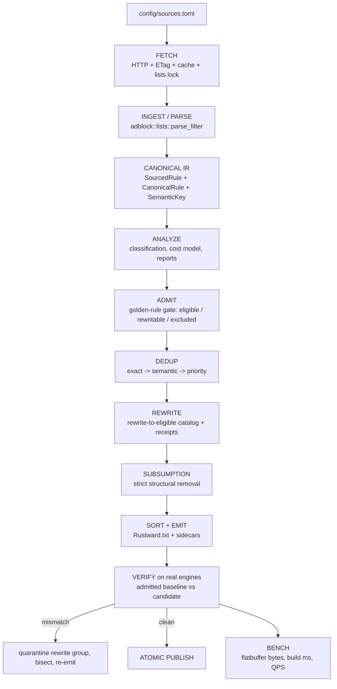

# Rustward — Architecture Design

**Status:** implemented; published by GitHub Actions on manual trigger and every 2 days.
**Target engine:** Brave `adblock-rust` (`adblock` crate), pinned to `=0.13.6`.
**Primary output:** `dist/Rustward.txt` — one deterministic, deduplicated, semantics-preserving,
engine-optimized unified filter list, plus auditable sidecar reports.

---

## 1. Purpose and scope

Rustward is an offline **list compiler**, not a browser component. It ingests many third-party
filter lists (EasyList, EasyPrivacy, hosts lists, regional lists, privacy lists, etc.), parses them
with the *actual* rust-adblock parser, classifies them by what rust-adblock can and cannot optimize,
deduplicates, safely rewrites rules that rust-adblock supports but does not optimize, verifies the
result against the real engine, and emits `dist/Rustward.txt`.

### Non-goals

- Reimplementing rust-adblock's matching semantics in the generator.
- Forking `adblock-rust`; it stays a pinned dependency and the single source of truth.
- Generic ABP/uBO list tooling (we optimize for rust-adblock's data model specifically).
- Runtime/browser integration, list subscription UI, or network proxying.

### Success criteria

| Metric | Target |
| --- | --- |
| Decision mismatches vs. baseline engine on verification corpus | **0** (hard gate) |
| Determinism: same inputs + same lockfile ⇒ byte-identical `Rustward.txt` | **required** |
| Rule-count reduction on typical EasyList+EasyPrivacy union | 30–60% |
| Engine flatbuffer size reduction with optimizer *disabled* | ≥ 20% |
| Engine construction time for emitted list | no worse than raw-baseline; target ≥ 10% faster |
| Rules failing the fast-native/official/engine-trusted gate in `Rustward.txt` | **0** (hard gate) |
| Ineligible rules that were neither rewritten to eligible nor excluded | **0** (hard gate) |
| Reproducible provenance for every output rule | **required** |

---

## 2. What rust-adblock actually optimizes (ground truth)

This design is based on reading `adblock-rust` 0.13.6 source and running a local probe program
against it. These facts drive the whole architecture.

### 2.1 The engine's runtime optimizer is deliberately narrow

`src/optimizer.rs::is_filter_optimizable_by_patterns` only accepts a network filter when **all** of
these hold:

- no `$domain=` / `$from=` (no `opt_domains`, no `opt_not_domains`),
- no `$to=` / `$denyfrom=` (no `opt_to_domains`, no `opt_not_to_domains`),
- not hostname-anchored (no `||`),
- not `$redirect`, not `$csp`.

And `src/filters/fb_network_builder.rs` only defers such a rule to the optimizer when it also has
**no usable index token** (`FilterTokens::Empty`). Additionally, the `$removeparam` bucket explicitly
disables optimization.

The optimizer then groups by `(NetworkFilterMask bits, is_complete_regex)` and fuses the group's
patterns into one internal `FilterPart::AnyOf`. It never fuses across different masks, domains, or
modifier payloads.

**Consequence:** the majority of real-world rules — `||host^`, anything with `$domain=`, redirects,
CSP, removeparam, cosmetic rules — receive *no* engine-side fusion. That is the gap Rustward fills.

### 2.2 Verified semantic equivalences and pitfalls

Probe results (`adblock` 0.13.6), reproduced in the appendix:

| Observation | Implication for Rustward |
| --- | --- |
| `P$script` + `P$image` behaves identically to `P$script,image` (same decisions, smaller flatbuffer) | Safe type-option union rewrite |
| `P$domain=d1` + `P$domain=d2` ≡ `P$domain=d1\|d2` | Safe domain union rewrite |
| `ads\|banner` parses as **one literal pattern containing `\|`**, not two patterns | **Never** emit concatenated patterns; only the engine's internal `AnyOf` is a union |
| `-ad--ads--advert-` does not match what `-ad-`, `-ads-`, `-advert-` match | Confirms the above |
| `P$script$badfilter` produces a *different mask* from `P$script`; correct syntax is `P$script,badfilter` | Rewrites must re-parse generated text and compare parsed fields, not trust string construction |
| Merging rules breaks a `$badfilter` that targets only one of them | `$badfilter` is a hard barrier: pinned, and its targets excluded from rewrites |
| `||host^` without explicit type gets `FROM_ALL_TYPES` (implicit document matching) | Rewrites must compare parsed `NetworkFilterMask` exactly, never textual modifiers alone |
| Hosts format is parsed to a `||hostname^` equivalent; `localhost` is ignored | Canonicalize hosts lists early, then run normal dedup |
| Cosmetic builder dedups selectors per hostname, but host unions still reduce source parse work | Cosmetic host merging is a size win, not a big memory win |
| `Engine::get_debug_info().flatbuffer_size` (needs `debug-info` feature) exposes real engine memory | Use it as the primary optimization metric, not source-line count alone |

### 2.3 Engine APIs the design relies on

- `lists::parse_filter(line, debug=true, ParseOptions)` → `ParsedLine::Network(Cosmetic)` with
  public `NetworkFilter` fields (`mask`, `features_mask`, `filter`, `hostname`, `opt_domains`,
  `opt_not_domains`, `opt_to_domains`, `opt_not_to_domains`, `modifier_option`, `tag`).
- `NetworkFilter::get_id()` → semantic ID used by the engine's own `$badfilter` pruning
  (computed from parsed fields, excluding the `BAD_FILTER` bit; **does not include `tag`**, so our
  own semantic key must add `tag`).
- `Engine::new_with_filter_set` (optimizer on) and `Engine::new_with_filter_set_no_optimize`.
- `Engine::check_network_request`, `check_network_request_subset`, `get_csp_directives`,
  `url_cosmetic_resources`, `hidden_class_id_selectors`, `get_debug_info`, `serialize`.
- `lists::read_list_metadata` for `! Title`, `! Homepage`, `! Expires`, `! Redirect`.
- `CosmeticFilter::plain_css_selector()` and the `CosmeticFilterOperator` enum for classifying the
  cosmetic selector path.

### 2.4 Golden rule: fast-native, official, engine-trusted output only

`Rustward.txt` is an **allowlist**, not a denylist. Every emitted rule must satisfy all three
properties:

1. **Fast-native.** It parses with rust-adblock's own syntax and does not rely on slow/complex
   machinery: regex fusion, XPath, upward traversal, style/path/text matching beyond the tiny
   procedural allowlist, chained procedural operators, DOM action operators, or unsupported dialect
   syntax.
2. **Official.** Any referenced executable content — scriptlet or redirect resource — comes from a
   pinned, content-addressed snapshot of uBlock Origin's official library. No hand-written or
   third-party JS is emitted.
3. **Engine-trusted.** The generated `Resource` permission bits are satisfied by the source's
   `PermissionMask`, including the full dependency closure, and the engine actually realizes the
   injection/redirect. Trust is never inferred from a scriptlet name.

| Class | Eligible for emission | Ineligible handling |
| --- | --- | --- |
| Native network rules (block/exception/important/badfilter/tag/generichide) | Parsed engine-native rule, no slow option payload | Attempt a safe rewrite to an eligible form; otherwise exclude with reason |
| Redirection / CSP / removeparam network rules | Payload is supported and any resource is official + engine-trusted | Rewrite alias/payload only if provably equivalent; otherwise exclude |
| Cosmetic hide / unhide | Single native CSS selector, or one allowlisted lightweight procedural operator | Normalize only if result stays eligible; otherwise exclude |
| Scriptlet rules | `##+js(...)` from the official library, grade recorded, permission + realization gates pass | D11 admits or excludes; no pass-through |
| Injected CSS/JS, HTML filters, action operators, complex procedural operators | Never | Exclude; D5/D7/R11 stay removed/disabled |
| Network patterns flagged `IS_REGEX` only because of `^` separators | Literal apart from the separator token, with no `*`, `/.../`, or hostname wildcard; redundant punctuation escapes are canonicalized away | **Allowed** when `admit.literal_boundary_regex = true`; the engine compiles these to a bounded generated matcher, not a user-authored regex |

adblock sets `IS_REGEX` whenever a pattern contains `*` or `^`. For non-complete patterns the engine
escapes punctuation (`+`, `(`, `[`, `.`, …) and expands `^` to a separator class, so the pattern is
still a literal URL matcher. Backslash escapes of that punctuation are redundant and are removed by
`network_canonicalization` before emission; real regex escapes (`\d`, `\n`, `\p{...}`, …) keep the
rule in the excluded `REGEX` family. Full regexes (`/.../`), hostname wildcards
(`IS_HOSTNAME_REGEX`), and path wildcards (`*`) remain excluded. The class is controlled by
`admit.literal_boundary_regex` and is checked by both ADMIT and the golden-rule assertion in
verification.

**Rewrite-or-exclude.** `analyze` labels every rule `ELIGIBLE`,
`REWRITABLE_TO_ELIGIBLE`, or `INELIGIBLE`. Rules in the second class are handed to the rewriter;
successful candidates become `ELIGIBLE`, and failed candidates become `EXCLUDED` with a receipt.
An already eligible rule that the engine cannot fuse is **retained** — fusion is a size win, not an
admission requirement. `$badfilter` is resolved at build time (see §7.3.2): the badfilter lines are
excluded from output, their matching targets are pruned, and both remain in the verification baseline
so the differential gate proves the resolution is semantics-preserving. Badfilter rules are hard
barriers — never rewritten, deduplicated, or subsumed.

**Cosmetic tiers.** Tiers 0 and 1 stay first-class; tier 2 is the only permitted scriptlet path.

| Tier / parsed shape | Engine bucket | Cost | Policy |
| --- | --- | --- | --- |
| 0 — `CssSelector` only, no action, no script | `hostname_hide` / generic CSS hide | Fast: real CSS, deduplicated by selector | **Allowed** |
| 1 — one lightweight procedural operator on a plain CSS subject | `procedural_action` JSON | Moderate: content-script evaluation | **Allowed only from the small allowlist below** |
| 2 — vetted uBO scriptlet passing the dual gate below | `inject_script` | Higher: real JS injection | **Allowed only via D11** |
| Complex/chained procedural operators, regex-valued procedural args | `procedural_action` JSON | Slow/complex | Rewrite if provably eligible; else exclude |
| Action operators, `#$#`, `#%#`, HTML filters, unknown scriptlets | extra machinery | Slow/unsupported | **Excluded** |

**Batch slow/complex exclusion.** ADMIT first removes whole rule families named in
`admit.exclude_families`, recording each removal as `BATCH_EXCLUDED` with the family in the analysis
metrics. The default is `["nested_procedural"]`: adblock folds some nested slow operators into a
single `CssSelector`, so they would otherwise pass the tier-0 shape check. The classifier also
recognizes `regex`, `literal_boundary_regex`, `light_procedural`, `vetted_scriptlet`,
`action_operator`, and `semantic_gap` for future batch gates; those are not excluded by default.
VERIFY applies the same family gate to its golden-rule assertion.

Allowed native CSS is any selector parsing to a single `CssSelector` with no action — including
`:has()`, `:not()`, combinators, attribute selectors, and non-procedural pseudo-classes. The default
lightweight procedural allowlist is `:has-text(literal)` and `:matches-attr(literal-name)`; literal
arguments only, no `/regex/`, one operator. It can be reduced further by config.

**Vetted scriptlet dual gate (D11).** A `##+js(name, args...)` rule is admitted only if:

1. **uBO provenance and grade.** `name` (or an alias) exists in a pinned snapshot of uBlock Origin's
   official scriptlet library (`src/js/resources/scriptlets.js` and its imported modules). The build
   records the upstream commit, file sha256, aliases, dependencies, and parsed grade: `standard` for
   ordinary built-ins or `trusted` when `requiresTrust: true`. Scriptlet names are case-sensitive
   identifiers; the parser preserves the official spelling so aliases such as `no-setTimeout-if`
   and `addEventListener-defuser` resolve instead of being folded to an unknown lowercase name.
   Rustward uses explicit per-source
   `trusted = true`; it never guesses trust from a `uBlock filters – …` title.
2. **adblock-rust trust.** `standard → PermissionMask::default()`; `trusted → TRUST_BITS` granted only
   to configured trusted sources. Admission requires
   `resource.permission.is_injectable_by(source.permissions)` for the resource and every dependency.
3. **Engine realization.** After engine construction, `url_cosmetic_resources(host).injected_script`
   must contain the invocation. This catches silent skips from insufficient permission, missing
   dependencies, or non-injectable resource kinds. Differential verification compares the multiset
   of independent `try { ... } catch` blocks, not their concatenation order, because compiler-friendly
   re-emission intentionally changes rule order.

Failures are excluded with `UNKNOWN_RESOURCE` (name not in the pinned snapshot or unresolved
dependency), `ENGINE_TRUST` (grade, permission, kind, or realization failure), or the ordinary parse
and policy codes. Details are written to the `detail` column of `reports/excluded.tsv` and identify
whether the resource was a `scriptlet` or a `redirect resource`. The same official+trust gate applies
to `$redirect` resources, with a trailing `:N` redirect priority stripped before catalog lookup. A
resource that is absent from the pinned official uBO assets remains excluded rather than emitted.

---

## 3. Design principles

1. **The engine is the oracle.** Every parse, equivalence check, and verification uses
   `adblock-rust` itself. No hand-written ABP parser in the generator.
2. **Conservative by default.** A rewrite is applied only if structural preconditions hold *and*
   the generated text re-parses into the expected field values *and* differential verification
   passes. An ineligible rule that cannot be safely made eligible is excluded, not passed through.
3. **`$badfilter` is a barrier resolved at build time.** Badfilter lines are excluded from the
   output and their targets are pruned before publication; both stay in the verification baseline.
   They are never deduplicated, rewritten, or subsumed, and their target IDs are pinned against all
   transformations.
4. **Determinism everywhere.** `BTreeMap`/`BTreeSet`, sorted vectors, bytewise string ordering,
   LF endings, fixed RNG seed, no wall-clock data in the list body. Build metadata is content-based.
5. **Auditability.** Every dropped, deduplicated, or rewritten rule has a receipt with source ids,
   line numbers, and reason. `Rustward.txt` is reproducible *and explainable*.
6. **Verify before publish.** The candidate engine is compared against a baseline engine on a
   generated + curated request corpus. Publish is atomic and gated on zero mismatches.
7. **Golden rule on every output rule.** Emit only fast-native, official, engine-trusted rules
   (§2.4). Non-fusable rules that are already eligible stay; ineligible rules are rewritten into
   eligible form when provably safe and excluded otherwise.
8. **Fast cosmetics first, vetted scriptlets only as fallback.** Prefer native CSS, then the tiny
   lightweight-procedural allowlist from §2.4. Scriptlets and redirect resources need the dual
   official-library/engine-trust gate. No action operators, injected CSS/JS, XPath, upward traversal,
   style/path matching, or chained procedural operators.

---

## 4. High-level pipeline



Stages are independently runnable CLI subcommands but the default `rustward build` runs all of
them. Stage outputs are cached as content-addressed artifacts so a source that did not change
does not get re-parsed or re-analyzed.

---

## 5. Workspace / crate layout

```
Rustward/
├── Cargo.toml                      # workspace, pinned adblock dependency in [workspace.dependencies]
├── config/
│   ├── sources.toml                # source registry + per-source trust (checked in)
│   ├── profiles.toml               # engine feature profiles (desktop / mobile / wasm)
│   └── resources/                  # pinned official uBO snapshot + generated Resource JSON
├── crates/
│   ├── model/            # IR types, SemanticKey, config schema, errors, traits
│   ├── fetch/           # HTTP, conditional GET, cache, lockfile, redirect handling
│   ├── parse/           # engine-backed parser wrapper -> IR
│   ├── analyze/         # classification, statistics, cost model
│   ├── admit/           # golden-rule gate, official-resource + trust checks
│   ├── dedup/           # exact + semantic dedup, source priority
│   ├── rewrite/         # rewrite-to-eligible catalog, safety framework, subsumption
│   ├── emit/            # deterministic sort, text emission, sidecar reports
│   ├── verify/          # corpus generation, differential tests, benchmarks
│   └── cli/                 # clap orchestration and staged publishing
├── corpus/                         # fixtures + optional real request corpora (CSV/JSONL)
├── tests/fixtures/                 # golden lists, badfilter traps, hosts, cosmetic edge cases
├── docs/ARCHITECTURE.md            # this document
└── dist/                           # generated output, committed by GitHub Actions
    ├── Rustward.txt
    ├── Rustward.txt.sha256
    ├── lists.lock
    └── reports/                    # build.json / build.md / rewrites.tsv / verify.json / bench.json
```

The split is deliberately along pipeline boundaries. If a single-crate build is preferred for the
first milestone, the same module names can live under `src/` and be split later without changing
interfaces.

`[workspace.dependencies]` pins `adblock = { version = "=0.13.6", features = [...] }` so a crate
upgrade is an explicit, verified event.

---

## 6. Canonical data model (`model`)

### 6.1 Sourced line

```rust
pub struct SourcedLine {
    pub source_id: SourceId,        // config id
    pub line_no: usize,
    pub text: String,               // after BOM/CRLF normalization, before dialect directives
    pub effective_text: Option<String>, // after !#include / !#if evaluation (D9)
    pub dialect: Dialect,           // Abp | Adguard | Ubo | Hosts | Auto
    pub trusted: bool,              // explicit per-source trust, never inferred from title/name
    pub permissions: PermissionMask, // engine bits granted to this source's rules
    pub raw_hash: [u8; 32],
}

pub enum LineOutcome {
    Network(NetworkRule),
    Cosmetic(CosmeticRule),
    Comment,
    Metadata(FilterListMetadata),
    Directive(Directive),           // !#include / !#if / !#else / !#endif
    Empty,
    Unsupported { error: ParseErrorKind, dialect_gap: Option<DialectGap> },
}
```

### 6.2 Canonical network rule

Holds both the parsed engine view (for equivalence decisions) and the canonical text form (for
emission):

```rust
pub struct NetworkRule {
    pub action: NetworkAction,      // Block | Exception | Redirect | Csp | RemoveParam
                                    // | GenericHide | BadFilter | Tagged
    pub pattern: Pattern {
        pub hostname: Option<String>,       // from ||host...
        pub body: PatternBody,              // Simple(String) | Regex(String) | Empty
        pub left_anchor: bool,              // | or ||
        pub right_anchor: bool,             // |
        pub hostname_regex: bool,
    },
    pub mask: u32,                  // exact NetworkFilterMask bits from the engine
    pub features: u32,              // exact NetworkFilterFeaturesMask bits
    pub domains: DomainSet,         // opt_domains / opt_not_domains (source)
    pub to_domains: DomainSet,      // opt_to_domains / opt_not_to_domains (destination)
    pub modifier_option: Option<String>,   // redirect target / csp / removeparam payload
    pub tag: Option<String>,
    pub important: bool,
    pub match_case: bool,
    pub source_dialect: Dialect,     // dialect the rule was written in
    pub canonical_dialect: Dialect,  // always Rust-adblock-compatible syntax
    pub dialect_gaps: Vec<DialectGap>, // e.g. DenyAllow, EntityDomain, MatchCaseNeedsRegex
    pub text: String,               // canonical source spelling used for emission
    pub provenance: SmallVec<[Origin; 4]>,
    pub eligibility: Eligibility,   // golden-rule admission state
    pub state: RuleState,           // Active | Pinned | Excluded(Reason) | Rewritten(Id)
}
```

### 6.3 Canonical cosmetic rule

```rust
pub enum CosmeticPayload {
    NativeCss(String),              // single CssSelector, no action/script
    LightProcedural {               // one allowlisted operator on a plain CSS subject
        css: String,
        op: FastOperator,           // HasText(Literal) | MatchesAttr(Literal)
    },
    VettedScriptlet {               // D11: official library + engine trust + realization
        name: String,               // canonical official name, aliases resolved
        args: Vec<String>,
        grade: ScriptletGrade,      // Standard | Trusted (from upstream metadata)
        resource_digest: [u8; 32],
        permission: PermissionMask,
    },
}

pub enum Eligibility {
    Eligible,                       // fast-native + official + engine-trusted
    RewritableToEligible,           // try safe rewrite catalog; failure => Excluded
    Ineligible(ExclusionReason),    // no safe rewrite exists; excluded with a reason
}

pub struct CosmeticRule {
    pub hosts: DomainSet,           // hostnames + entities, plus negated variants
    pub payload: CosmeticPayload,
    pub action: HideOrUnhide,       // Style/Remove/RemoveAttr/RemoveClass are rejected earlier
    pub eligibility: Eligibility,
    pub generic: bool,              // no hostname constraint
    pub text: String,
    pub provenance: SmallVec<[Origin; 4]>,
    pub dialect_gaps: Vec<DialectGap>,
    pub state: RuleState,           // Active | Pinned | Excluded(Reason) | Rewritten(Id)
}
```

### 6.4 Semantic key

- **Network (Stage 5):** `hash(engine_id, tag, source_permissions)` where
  `engine_id = NetworkFilter::get_id()`. We add `tag` and the source permission bits because
  `get_id()` intentionally excludes both, yet both change behavior (active-tag filtering and resource
  permission checks). Without them, a tagged rule could collapse into an untagged one or a trusted
  resource rule into an untrusted one. Dialect aliases (`from`→`domain`, `3p`→`third-party`,
  `rewrite`→`redirect`, …) are normalized before hashing; the source dialect itself is not part of the
  key, because the output dialect is fixed.
- **Cosmetic (Stage 5):** stable hash over canonical `(hosts, negated hosts, entities, payload,
  selector ops, action, action detail, generic flag, resource permission, source permissions)`;
  `CosmeticFilter` has no public id accessor. Extended-CSS operator aliases and official scriptlet
  aliases are canonicalized before hashing. Vetted scriptlets include the official resource digest
  and permission in the key so two spellings with different resources or trust never collapse.
- **Badfilter targets:** set of `get_id()` values of all `$badfilter` rules. Any rule whose
  `engine_id` is in this set is pruned at build time (§7.3.2); both it and the badfilter line remain in
  the verification baseline. Badfilters are barriers and are never keyed, rewritten, or deduplicated.

### 6.5 Rewrite receipt

```rust
pub struct RewriteReceipt {
    pub id: RewriteId,
    pub kind: RewriteKind,
    pub before: Vec<RuleFingerprint>,   // source id + line no + raw text
    pub after: String,
    pub structural_checks: Vec<Check>,
    pub reparse_check: ReparseCheck,
    pub differential_check: DifferentialCheck,
}
```

Receipts are written to `reports/rewrites.tsv` and are also the unit of rollback: on a verification
mismatch, all rewrites in the responsible group/family are reverted and the pipeline re-emits.

---

## 7. Stage details

### 7.1 Fetch (`fetch`)

- `reqwest` (rustls, blocking) with a 30-second per-request timeout and at most one redirect.
- Every HTTP(S) source must carry a `sha256` pin in `config/sources.toml`. The pin is verified
  against the raw bytes, so an upstream change fails the build until `rustward update-pins` is run
  and the config diff is reviewed.
- Conditional GET using the previous `dist/lists.lock` (`If-None-Match`, `If-Modified-Since`); `304`
  reuses the cached blob.
- Store raw bytes in `cache/blobs/sha256/<digest>`. `build --offline` is cache-only and fails if a
  pinned blob is absent. `current_sha256()` used by `update-pins` bypasses pins and cache.
- `!#include` tokens are resolved relative to the parent URL and each included file must be pinned
  in `include_sha256`, making directive expansion deterministic. Included blobs are cached and
  recorded under the source's `includes` section in `dist/lists.lock`.
- Normalization: strip UTF-8 BOM, verify UTF-8, normalize CRLF → LF, drop trailing whitespace.
- Lockfile records source id, final URL, etag, last-modified, sha256, byte count, fetched_at,
  dialect, format, priority, enabled, trusted, permissions, and license note.
- Attribution: source id and license note from config are carried into the IR and lockfile.

### 7.2 Ingest / parse (`parse`)

- Before parsing, run the **directive pass** (D9): evaluate `!#if` / `!#else` / `!#endif` for the
  pinned target environment and expand `!#include` from a content-addressed include tree. The
  resulting `effective_text` is what reaches the engine. Both the raw and effective text are kept
  for provenance.
- One call per effective line: `parse_filter(line, /*debug=*/true, ParseOptions { format,
  rule_types: All, permissions })`. `debug=true` keeps `raw_line` for provenance.
- Classify every line, including failures (`Unsupported`, `Empty`, `Directive`, network/cosmetic
  error kinds). Attach a `DialectGap` to every failure that is explainable by source dialect
  (`denyallow`, `#%#`, `$all`, entity domains, …).
- **Structured `$` option parsing (Stage 4).** The raw option string is parsed into named
  `(name, value, negated)` entries before gap detection. `$denyallow`, `$all`, `$rewrite`,
  `$queryprune`, `$match-case`, entity domains (`.*`), dropped `$method=`/`$scheme=` values, and
  uBO bare-hostname intent are reported from parsed fields rather than substring matches. The engine
  remains authoritative for semantics; this parser only exposes option *shape* so a gap cannot be
  missed by a spelling change.
- **Engine feature profile matters.** The generator and the target browser must agree on
  `full-regex-handling` (otherwise `/regex/` rules are rejected), `css-validation` (otherwise
  malformed CSS may be accepted), and `embedded-domain-resolver`. Profiles live in
  `config/profiles.toml`; the selected profile hash goes into the output header and manifest.
- **`$badfilter` identity.** `NetworkFilter::get_id()` excludes the `BAD_FILTER` feature bit, so a
  parsed badfilter's `engine_id` is the identity of the rule it cancels. Targets are resolved at
  build time (§7.3) and both the badfilter lines and their targets are kept in the verification
  baseline.
- Hosts-format sources use `FilterFormat::Hosts`; they are canonicalized to `||host^` text early.
- Parse results are cached by (blob hash, dialect, profile hash, directive environment hash), so
  unchanged lists are not re-parsed and a profile change cannot silently reuse stale results.

### 7.3 Analyze (`analyze`)

Per source and globally, produce:

- Counts: raw lines, effective lines, directives, comments, metadata, network, cosmetic, parse
  errors by reason, and **dialect** (`abp` / `adguard` / `ubo` / `hosts` / `auto`).
- Rule-shape histogram: exceptions, important, badfilter, tagged, `$domain`, `$to`, `$~domain`,
  `$redirect`, `$csp`, `$removeparam`, `$generichide`, regex/full-regex, hostname-anchored,
  generic cosmetic, procedural cosmetic, scriptlets, plus dialect-specific syntax.
- **Dialect-gap histogram:** `denyallow`, negated-only `$to`, entity/regex domains, `$all`,
  `queryprune`, `#$#`, `#%#`, unsupported scriptlets/options, dropped `$method` values,
  and uBO bare-hostname patterns. Each gap is classified as `ENGINE_NATIVE`,
  `CANONICALIZED`, `SEMANTIC_GAP`, or `UNSUPPORTED`.
- **Cosmetic cost classification:** `FAST_NATIVE_CSS`, `LIGHT_PROCEDURAL`, `VETTED_SCRIPTLET`,
  `BLOCKED_SLOW`, with counts by operator and reason. Blocked examples: `MatchesCss*`,
  `MatchesPath`, `MinTextLength`, `Upward`, `Xpath`, chained operators, regex-valued procedural
  args, all `action` operators, unvetted `+js(...)` scriptlets, `#$#`, `#%#`, HTML filters.
- **Golden-rule admission classification:** `ELIGIBLE`, `REWRITABLE_TO_ELIGIBLE`,
  `INELIGIBLE(reason)`, with counts by rule class, source dialect, and exclusion reason. This is the
  input to `admit`; `INELIGIBLE` rules never reach dedup unless a rewriter claims them.
- **Optimizability classification**, mirroring the engine exactly:
  - `ENGINE_FUSABLE` — passes `is_filter_optimizable_by_patterns`, has `FilterTokens::Empty`, and
    belongs to an optimizer-enabled bucket. Leave these alone; the engine fuses them at load time.
  - `SUPPORTED_NOT_OPTIMIZED` — parses successfully but fails one of those conditions. These are
    rewrite candidates when a rule is also ineligible or fusible-equivalent; otherwise they are
    retained as fast-native/trusted rules.
  - `UNSUPPORTED` — parse failure. Reported, never emitted as active rules.
- Cost model: estimated flatbuffer bytes and index buckets before optimization, measured after
  building both optimized and no-optimize engines.
- Outputs `reports/analysis.json` and a human-readable `reports/analysis.md` with the top duplicate
  clusters and the largest unoptimizable groups.

#### 7.3.1 Golden-rule admission (`admit`)

This stage enforces §2.4 before dedup so only eligible or rewritable rules reach later stages:

1. **Structural check:** parsed rule must be an engine-native rule in a supported bucket.
2. **Cost check:** reject regex rules/fusion candidates, slow procedural operators, action operators,
   and injected CSS/JS unless a registered D rewrite can transform them into an eligible form.
3. **Official-resource check:** resolve every scriptlet/redirect name through the pinned official
   snapshot; record alias, grade, digest, dependencies, and source trust. The importer must handle
   uBO's current ES-module layout and emit canonical `Resource` JSON; it cannot assume the legacy
   `/// name` format still parsed by `resource_assembler.rs`.
4. **Engine-trust check:** require `resource.permission.is_injectable_by(source.permissions)` for the
   resource and its dependency closure.
5. **Verdict:** `ELIGIBLE`, `REWRITABLE_TO_ELIGIBLE`, or `INELIGIBLE(reason)`. Rewritable rules carry
   the candidate rewrite family ids; ineligible rules are written to `reports/excluded.tsv` with the
   original line and reason.

Already eligible rules that the engine cannot fuse stay in the set. The admission gate is an
allowlist: any rule that cannot prove eligibility is a candidate for rewrite or exclusion, never a
silent pass-through.

#### 7.3.2 Build-time `$badfilter` resolution

`admit` resolves `$badfilter` before publication instead of emitting those lines verbatim:

1. For each badfilter line, `NetworkFilter::get_id()` yields the engine id of its target (the
   `BAD_FILTER` bit is deliberately excluded from that hash). These ids form the target set.
2. Badfilter lines are recorded as `BadfilterResolved` exclusions and are **not** admitted to output.
3. Any non-badfilter rule whose `get_id()` is in the target set is recorded as `BadfilterTarget`
   and pruned from output.
4. Both the badfilter lines and their targets remain in the **verification baseline** (which mirrors
   what the engine would load from the raw lists), so `verify` proves that removing both sides is
   semantics-preserving. This keeps the list slimmer without changing behavior.

Receipts report `badfilter_resolved` and `badfilter_targets_pruned` counts. A badfilter and its
targets are hard barriers: never rewritten, deduplicated, or subsumed.

### 7.4 Dedup (`dedup`)

Three ordered passes:

1. **Exact textual dedup** after BOM/whitespace normalization. Provenance is unioned; the shortest
   spelling wins (ties broken by source priority, then line number).
2. **Semantic dedup** via `SemanticKey` (Stage 5). For network rules the key is the engine id plus
   the `$tag` and the source `PermissionMask`, because `get_id()` deliberately omits both: two rules
   can share an engine id yet behave differently under tag filtering or resource permission checks.
   For cosmetic rules the key is the canonical tuple of hosts, negated hosts, entities, payload,
   selectors, action, genericity, and both permission fields. Rules collapse even when spelled
   differently (`$from=` vs `$domain=` aliases, reordered options, punycode vs Unicode hostnames).
3. **Priority resolution** across sources: `config` priority decides which source's text is kept.
   Every merge records all origins in the receipt; an equal-exact-text collision keeps the highest
   priority source rather than relying on iteration order.

Hard exclusions: `$badfilter` rules are never deduplicated (their precise text/ID matters, and they
are resolved at build time in §7.3.2), `INELIGIBLE` rules are absent before dedup, and scriptlets are
deduped only after D11 has resolved their canonical official name, grade, resource digest, and
`PermissionMask`. Different trust grades or digests never collapse into one key.

### 7.5 Classify (`analyze`, reused)

Rules are partitioned into buckets that mirror `NetworkFilterListId`:

`Filters`, `Exceptions`, `Importants`, `GenericHide`, `Csp`, `Redirects`, `RemoveParam`,
`TaggedFilters*`, `BadFilter` (pinned), then cosmetic: `GenericHideCss`, `HostHide`,
`HostLightProcedural`, `VettedScriptlet`, `Unhide`, and `Excluded` (dropped with reason, not emitted).
These names mirror `NetworkFilterListId` where it is public; the engine enum is `pub(crate)`, so the
mapping is mirrored and snapshot-tested rather than imported.

This partition is used (a) by rewriters to restrict their search space, (b) by the sorter to produce
a readable deterministic file, and (c) by verification to build targeted sub-engines for local
differential checks.

### 7.6 Rewrite (`rewrite`) — the core value-add

#### 7.6.1 Framework

```rust
pub trait RuleRewriter {
    fn family(&self) -> RewriteFamily;
    fn applicable_to(&self, rule: &CanonicalRule, ctx: &Ctx) -> bool;
    fn group_key(&self, rule: &CanonicalRule) -> GroupKey;   // what can be merged
    fn rewrite(&self, group: &[CanonicalRule], ctx: &Ctx) -> Option<RewriteProposal>;
}
```

A proposal carries the new text and the **expected parsed field delta**. Application pipeline:

1. Collect groups by `group_key` inside a single bucket.
2. Reject groups containing a pinned rule or a `$badfilter`.
3. Apply the rewriter to produce candidate text.
4. **Reparse check:** `parse_filter(candidate_text)` must succeed and its parsed fields must equal
   the expected union (mask equals the bitwise OR only where the rewriter claims widening; domains
   equal the sorted union; modifier option unchanged; no accidental extra flags).
5. **Local differential check:** build two tiny engines from `group` and from the candidate, run the
   group's generated corpus, compare decisions (see §8).
6. On success, replace the group with the candidate and emit a receipt. On failure for a rule that
   was admitted as `REWRITABLE_TO_ELIGIBLE`, set `Excluded(REWRITE_FAILED)`; for a group that was
   already `ELIGIBLE`, leave it untouched and emit a `Quarantined` report entry. A quarantined
   eligible rule must still pass the final golden-rule assertion before emission.

Rewriters run in a fixed order, up to three passes, until no further change. Each family is
idempotent and reports which other families it invalidates (e.g., domain union enables a later
subsumption check).

#### 7.6.2 Dialect knowledge layer (ABP / AdGuard / uBO / hosts)

Third-party lists are written in four related but **non-identical dialects**, plus an `auto`
detection mode. Every source carries a
`dialect = "abp" | "adguard" | "ubo" | "hosts" | "auto"` tag in `config/sources.toml`, and every
`SourcedLine` inherits it. The *target* dialect is fixed: **rust-adblock's own syntax**. Dialect
knowledge is used for (a) alias normalization, (b) flagging rules whose intended semantics the
engine cannot express, and (c) opt-in, intent-preserving rewrites. It is never used to silently
guess semantics.

**Network option compatibility** (verified against `adblock-rust` 0.13.6 parse + behavior):

| Option / aliases where used | Origin | rust-adblock 0.13.6 | Rustward action |
| --- | --- | --- | --- |
| `domain=`, `from=` | ABP / AG / uBO | Supported; values are hashed **literally** — entity `example.*` and `/regex/` values are not expanded (regex values are dropped, and an all-regex list errors with `NoSupportedDomains`) | Canonicalize alias; flag entity/regex values as semantic gaps, never "expand" them |
| `to=` | AG / uBO | Positive values work; **negated-only `$to=~` is effectively inert** (no positive destination bucket) | R3 only for positives; reject negative-only forms |
| `denyallow=` | AG / uBO | `UnrecognisedOption` | Report as unsupported. **Do not** rewrite to `$to=~…` — not equivalent in this engine (see Appendix B) |
| `all` | AG / uBO | Accepted, maps to `FROM_ALL_TYPES` | Keep, but report that uBO's `$all` additionally covers popup / document / inline-script / inline-font |
| `third-party`, `3p`, `first-party`, `1p` | all | Supported, aliases recognized | D3 canonicalization |
| `rewrite=abp-resource:*` | ABP | **Natively aliased** to `redirect` in the engine (including `abp-resource:` tokens) | D2 spelling normalization only; no semantic change needed |
| `redirect=`, `redirect-rule=` | uBO / AG | Supported | D11 applies the same official-resource + engine-trust gate as scriptlets; unresolved resources are excluded |
| `csp=` | all | Supported, document/subdocument only | Dedup only; never merge payloads |
| `removeparam=` | uBO / AG | Supported only for `[A-Za-z0-9_-]+` names; regex values rejected | Flag regex-valued rules unsupported; D8 for the `queryprune` alias |
| `important`, `badfilter`, `tag`, `match-case` | all | Supported, but `match-case` requires a full `/regex/` (plain patterns are rejected) | Badfilter barrier; D7 removed, plain `$match-case` quarantined via D10 |
| `generichide`, `ghide` | all | Supported **only on exceptions** (`GenericHideWithoutException` otherwise) | Keep as-is |
| `method=get\|head\|post` | AG / uBO | Only these three methods are recognized; other methods are silently filtered | Flag rules whose methods were dropped |
| `object-subrequest` | legacy ABP/AG | Aliased to `object` by the engine | D3 canonicalization, with a "legacy alias" note |
| `elemhide`/`ehide`, `specifichide`/`shide`, `popup`, `popunder`, `genericblock`, `urlblock`, `jsinject`, `content`, `stealth`, `extension`, `strict1p`, `strict3p`, `top`, `ipaddress`, `header`, `cname`, `permissions`, `inline-script`, `inline-font`, `replace`, `removeheader`, `jsonprune`, `hls`, `urltransform`/`uritransform`, `urlskip`, `webrtc` | dialect-specific | Unrecognized / removed | D10: report and drop or quarantine; never substitute a "close enough" rule without a differential gate |

**Cosmetic separator compatibility:**

| Syntax | Origin | rust-adblock 0.13.6 | Action |
| --- | --- | --- | --- |
| `##`, `#@#` | all | Supported; plain CSS goes to the fast `hostname_hide` path | R6 host unions apply when the selector is allowlisted |
| Native CSS pseudo-classes (`:has()`, `:not()`, combinators, attribute selectors) | all | Parsed as a single `CssSelector` | Allowed as fast native CSS |
| `#?#`, `#@?#` | ABP / AG extended CSS | Supported; engine translates some ABP/AG operators (`-abp-contains`, `contains` → `has-text`, etc.) | Allowed only if translation yields exactly one allowlisted lightweight operator; otherwise D10 |
| `:has-text(literal)`, `:matches-attr(literal-name)` | uBO / AG | Parsed as lightweight procedural operators | Allowed as `LIGHT_PROCEDURAL`; literal args only, no `/regex/`, single operator |
| `:matches-css*`, `:matches-path`, `:min-text-length`, `:upward`, `:xpath`, chained operators, regex-valued procedural args | uBO / AG | Parsed as procedural operators; some nested forms fold into a single `CssSelector` | **Excluded as `SLOW_COSMETIC_OPERATOR` (D10) or `BATCH_EXCLUDED` (`nested_procedural`)** unless D6 yields an eligible form |
| `#$#`, `#@$#` | AG CSS injection | **Explicitly rejected** by the parser | D10; D5 removed from the active catalog |
| `#%#`, `#@%#` | AG JS injection | **Explicitly rejected** | D10 |
| `##+js(...)` | uBO | Supported (scriptlet args + `PermissionMask`) | D11 admits only official-library scriptlets whose grade, permission gate, and engine realization pass; otherwise excluded |
| `##selector:style(...)`, `:remove()`, `:remove-attr()`, `:remove-class()` | uBO / AG | Supported as action operators | **Excluded**; actions are DOM-mutating and fail the golden rule |
| `example.*##.ad` | AG / uBO entity | Supported as an entity hash | Report entity rules separately; no plain-host merging with them |
| `!#include`, `!#if`, `!#else`, `!#endif` | uBO / AG pre-parsing directives | Treated as ordinary comments | D9: evaluate in the generator for the selected target profile before parsing rules |

**Never-silent dialect gaps:**

- **Bare-hostname ambiguity.** In uBO, `example.com` is treated as `||example.com^` (including the
  document); in ABP and in rust-adblock it is a plain substring pattern. R5 applies only to
  `FilterFormat::Hosts`. For Standard-format uBO sources, D1 is an explicit opt-in via
  `host_semantics = "ubo"`; otherwise the engine's ABP-style interpretation is kept and reported.
- **Entity / regex domains.** `$domain=example.*` is hashed as the literal string `example.*` and
  will not match real hostnames; `$domain=/regex/` is discarded. These rules are reported as
  ineffective in this engine, not rewritten into guesses.
- **`$all` narrowing.** uBO's `$all` includes popup and inline options that rust-adblock's mask
  cannot represent; the gap is documented in the report.
- **`$denyallow` → `$to=~` is not a valid simplification** in this engine version (Appendix B).
- **Directive evaluation must be deterministic and profile-specific** (`env_chromium`,
  `env_firefox`, `env_mobile`, `ext_ublock`, `adguard`, etc.), otherwise the same lockfile could
  produce different lists on different machines.

**Semantic-gap acceptance policy.** `admit.accepted_semantic_gaps` is the explicit allowlist of
`SemanticGap` classes that may pass ADMIT. The default accepts `all` (rust-adblock narrows popup and
inline bits but the remaining type bits are useful), `dropped_method`, and `dropped_scheme` (the
rule still works for supported values). All other semantic gaps are excluded with
`SEMANTIC_GAP_POLICY` and reported separately: entity domains hash as literal `example.*` strings,
bare uBO hostnames are substring patterns rather than host anchors unless a valid hostname is
detected, and `$match-case` requires regex machinery. `analysis.json` records accepted, unresolved,
and excluded semantic gaps by kind. VERIFY mirrors the policy in its golden-rule assertion.

#### 7.6.3 Rewrite catalog

The `R` family is dialect-independent optimization. The `D` family is dialect-aware normalization
and intent preservation. All entries still go through the same reparse and differential gates.

| # | Family | Transformation | Key preconditions |
| --- | --- | --- | --- |
| R1 | Type union | `P$script` + `P$image` → `P$script,image` | Same pattern, hostname, domains, party, schemes, important, tag, modifier payload, features; no badfilter pin |
| R2 | Domain union | `P$domain=d1` + `P$domain=d2` → `P$domain=d1\|d2` | Same everything except `opt_domains`; union include/exclude separately; punycode + lowercase canonicalization |
| R3 | To-domain union | Same for positive `$to=` destination sets | Same as R2 for `opt_to_domains` / `opt_not_to_domains`; `$from=` is a source-domain alias and is handled by R2; negated-only `$to=~` is rejected as inert |
| R4 | Party/scheme widening | `P$third-party` + `P$first-party` → `P`; `P$http` + `P$https` → `P` | Parsed mask after widening must be exactly the OR of input masks **and** must not trigger implicit `FROM_ALL_TYPES` or other side effects |
| R5 | Hosts canonicalization | `0.0.0.0 ads.example` → `||ads.example^` | Only for `FilterFormat::Hosts`; drop `localhost`, broad TLDs, invalid hosts per engine rules |
| R6 | Cosmetic host union | `d1##.ad` + `d2##.ad` → `d1,d2##.ad` | Selector must be allowlisted (native CSS or one lightweight procedural op); action must be `Hide`/`Unhide`; no permission payload; no `##@#`/generichide interaction; entities handled separately or skipped |
| R7 | Subsumption — hostname | `||sub.example.com^` dropped when `||example.com^` exists | Identical mask/features/domains/modifier payload; label-boundary suffix check; neither pinned nor badfilter-targeted; no exception in between |
| R8 | Subsumption — mask | `||x^$script` dropped when `||x^` exists | Pattern/domains/modifier identical; broader mask is a strict superset; no important/exception asymmetry |
| R9 | Subsumption — pattern | plain `ads` makes plain `ads-banner` redundant | Both plain, unanchored identically, no regex, no `^`/`\|` boundary semantics violated; verified by corpus |
| R10 | Subsumption — domain | `P$domain=d1\|d2` dropped when `P` exists with otherwise identical fields | No exceptions between; pinned rules excluded |
| R11 | Regex fusion *(experimental, off by default)* | many `||hostN^` → one full regex `/^https?:\/\/(?:h1\|h2\|...)(?:[\/^:?#]\|$)/` | Only with `full-regex-handling`; requires benchmark win and full differential gate; disabled by default because regex matching is usually slower |
| R12 | Cosmetic generic promotion | host-specific plain-CSS hide with *all* known hosts → generic `##.ad` | Only when host set covers configured corpus domains; off by default |
| R13 | Exception type union | `@@P$script` + `@@P$image` → `@@P$image,script` | Same pattern, hostname, domain sets, party, schemes, important, tag, modifier payload, and features; exception marker preserved; no badfilter pin |
| R14 | Exception domain union | `@@P$domain=d1` + `@@P$domain=d2` → `@@P$domain=d1\|d2` | Positive `$domain=`/`$from=` lists only; no `~` values, no badfilter pin; parsed exception mask and non-domain fields must match; engine differential corpus covers every source domain |
| D1 | uBO bare-hostname intent *(opt-in, off by default)* | `example.com` → `||example.com^` for Standard-format uBO sources | Only when source sets `host_semantics = "ubo"`; never for ABP/AdGuard/hosts sources; must pass document-vs-substring differential corpus |
| D2 | ABP redirect alias | `rewrite=abp-resource:X` → engine-native `redirect=X` spelling | Engine already aliases both forms (identical mask/modifier); this is spelling normalization only; resource names are not translated |
| D3 | Dialect alias canonicalization *(implemented as `network_canonicalization`)* | `from`→`domain`, `3p`→`third-party`, `1p`→`first-party`, `object-subrequest`→`object`, `css`→`stylesheet`, `frame`→`subdocument`, `xhr`→`xmlhttprequest`, `beacon`→`ping`, `doc`→`document`, `ghide`→`generichide` | Reparsed `engine_id`, `mask`, and `features_mask` must be identical; aliases with silently dropped values are flagged, not "fixed" |
| D4 | Option/pipe-order canonicalization *(implemented as `network_canonicalization`)* | Sort `$` options and `\|`-delimited domain lists deterministically | Mixed positive/negative domain lists keep their order to preserve last-match-wins; badfilter barriers and modifier payloads are never touched; every change passes reparse + engine differential gates |
| D5 | *(removed)* AdGuard CSS injection | `example.com#$#.ad { color: red }` → `example.com##.ad:style(color: red)` | **No longer enabled.** `:style(...)` is a DOM-mutating action and fails the golden rule; route these rules to D10 |
| D6 | Extended-CSS operator normalization *(implemented for literal contains)* | `:-abp-contains(...)`/`contains(...)`→`:has-text(...)` | Runs before ADMIT with a `d6_literal_contains` receipt. Only a single literal argument and exactly one allowlisted `has-text` operator qualify; the ABP extended form is retained as the VERIFY baseline and engine differential equality is required. Regex arguments, chained operators, and action operators stay excluded; `:-abp-has(...)` remains open |
| D7 | *(removed)* `$match-case` upgrade | `/BannerAd.gif$match-case` → escaping + full-regex form with `match-case` | **No longer enabled.** Regex rewriting is slow/complex; plain `$match-case` rules are quarantined via D10 |
| D8 | Query-prune alias | `$queryprune=utm_source` → `$removeparam=utm_source` | Value must match the engine's `[A-Za-z0-9_-]+` restriction; regex-valued inputs are D10, not guessed |
| D9 | Pre-parsing directive evaluation | Resolve `!#include`, `!#if`, `!#else`, `!#endif` for the pinned target profile | Runs **before** parse; environment variables and include tree are hashed into the build id; unresolved branches are reported |
| D10 | Golden-rule exclusion | `denyallow`, `#%#`, `#$#`, `elemhide`, `popup`, `replace`, `cname`, unvetted `+js(...)`, all action operators, `:matches-css*`, `:matches-path`, `:min-text-length`, `:upward`, `:xpath`, chained/regex procedural operators, unresolved redirects, … | If no safe D rewrite yields an eligible form, emit the original line to `reports/excluded.tsv` with source dialect + reason; never pass through or substitute a "close enough" rule without a differential gate |
| D11 | Official-resource + engine-trust qualification | `##+js(name, args...)` and `$redirect=name` | Resolve name/alias in the pinned official uBO snapshot; record grade and resource digest; require `is_injectable_by(source.permissions)` for resource + dependency closure; require engine realization; otherwise D10 |

Notes:

- **R1/R2/R3/R13/R14 are the main workhorses** — verified equivalent, common in real lists, and
  reduce both source size and flatbuffer size (probe: two rules → one rule saves 32 bytes in the
  flatbuffer). R14 is especially effective for per-site unbreak rules for third-party analytics;
  collapsing thousands of single-domain `@@` rules into a few shared filter objects reduces the
  exception index without changing matching behavior.
- **R7–R10 are high-risk.** They are gated by strict structural predicates *and* differential
  verification, and each removal is logged with the subsuming rule id. R7/R8/R10 are implemented and
  enabled as `hostname_subsumption`, `mask_subsumption`, and `domain_subsumption` respectively. They
  group rules by a deterministic key of every field that must be identical (excluding only the one
  dimension being widened), require the broader sibling to be a strict superset, and gate every
  removal on `verify::network_equivalence`. Grouping keys use debug formatting rather than serde tuples
  so all network-rule fields can participate without a tuple-size limit.
- **Stage 7 (hostname-wildcard admission) was evaluated and admits zero rules.** A `||*.example.com^`
  hostname-regex rule matches *subdomains only*, while its fast-anchored counterpart `||example.com^`
  also matches the apex domain; the differential gate therefore rejects every such rewrite. Because
  admitting these rules would either broaden behavior or require blanket regex admission (both
  forbidden), none are emitted. The structural candidate check remains documented here so the
  decision is auditable, but no config flag is enabled for it.
- **No pattern concatenation.** Because `ads|banner` is a single literal pattern in this syntax,
  the generator never tries to emulate `FilterPart::AnyOf` in text. Engine-fusable rules stay as
  separate lines; the engine fuses them internally.
- **Scriptlets and redirects are dedup-only after D11.** The optimizer avoids them and their
  payloads carry distinct semantics; only official, engine-trusted resources may be emitted.
  CSP / removeparam payloads remain dedup-only and are excluded when unsupported.
- **`$badfilter` barrier.** Target IDs are computed with `get_id()` and pinned. Probe confirmed that
  merging `||a.com^$script` + `||a.com^$image` into `||a.com^$script,image` breaks a
  `||a.com^$script,badfilter` rule that previously cancelled only the script rule.
- **D2–D4/D6/D8 are pure canonicalization** and are additionally gated by the §2.4 allowlist: a
  normalization that would leave a slow procedural operator is rejected and routed to D10.
- **D1 is the only active intent bridge.** D5 and D7 were removed because they would emit slow
  regex/action machinery. D1 is opt-in and uses the dialect-specific corpus cases in §8.2.
- **D9 runs before the engine parser; D10 runs after analysis.** Both are recorded in receipts and
  reports so a rule never disappears without an explanation.
- **Output dialect is never mixed.** Regardless of input dialect, every emitted rule is parsed and
  verified as rust-adblock syntax; dialect metadata never leaks into `Rustward.txt` except as
  attribution comments.

#### 7.6.4 Safety invariant

For every rewrite, with `U` = universe of requests/features the engine can observe:

```
decisions(before_rules, r) == decisions(after_rule, r)   for all r in U
```

`U` is not enumerable, so we approximate with three layers: parsed-field equality (structural),
reparse equality (syntax), and a large generated corpus through the real engine (behavioral).
Anything that does not pass all three is not applied. Every candidate also has a non-negotiable
golden-rule postcondition: the reparsed rule must be `ELIGIBLE` under §2.4 — native network syntax,
native CSS / allowlisted lightweight procedural, or a D11-qualified official+trusted scriptlet/redirect.
No action operators, injected CSS/JS, or unvetted resources are emitted.

### 7.7 Sort and emit (`emit`)

Output text is ordered for **determinism, auditability, and fast engine construction**. Line order
does not define matching semantics in `adblock-rust`, but it changes parser/flatbuffer build locality
and the engine's `TokenSelector` choices. The emitter uses a versioned, benchmarked order
(`emit_order = "compiler-friendly-v1"`); the order is part of the build id and is snapshot-tested.

**Compiler-friendly canonical order** (bytewise, locale-independent):

1. Minimal generated header comments: build id, source attributions/licenses, counts, and
   `! Generated by Rustward — do not edit`.
2. `$badfilter` rules and their resolved targets are **not emitted**; both are resolved at build time
   (§7.3.2). `emit` applies a final filter so no badfilter line can leak into the output.
3. Network rules grouped by the engine's bucket order, mirrored from `NetworkFilterListId`
   (`Csp`, `Exceptions`, `Importants`, `Redirects`, `RemoveParam`, `Filters`, `GenericHide`,
   `TaggedFilters*`), with `@@$generichide` first inside `Exceptions`. The enum is `pub(crate)`, so
   the mapping is mirrored and snapshot-tested, not imported.
4. Inside each bucket, group by **index class**, mirroring `NetworkFilter::get_tokens()` in this
   order: single positive `$domain=` (most selective), pattern/hostname tokens (`Other`),
   `$removeparam` token, multi-domain `$domain=` buckets, `$to=` buckets, then empty-token rules. The
   primary index key is derived from public parsed fields (hostname labels, pattern tokens, sorted
   domain hashes); it is an ordering hint only, never a rewrite or semantic key.
5. Within an index class sort by `(index key, mask, features, hostname, pattern body, sorted domain
   set, modifier digest)`. This keeps identical shapes and payloads adjacent for string interning and
   token-selection locality.
6. Cosmetic sections: generic CSS hides, host-specific hides, allowlisted lightweight-procedural
   rules, `##@#` unhides, then D11-qualified scriptlets last. Sort CSS/procedural rules by
   `(selector, sorted hosts)`; sort scriptlets by `(official resource digest, grade, sorted hosts,
   args)` so identical injected resources are contiguous. Excluded actions/injected CSS/JS never
   appear.

The emitter verifies that this permutation is behavior-neutral: the corpus is run against the same
rules in source order and in canonical order, and both decisions and flatbuffer sizes/QPS must match
or improve. If a future engine version changes token selection materially, `emit_order` is bumped and
the order is re-benchmarked rather than silently kept.

Emission rules: UTF-8, LF only, no trailing whitespace, no blank-line padding beyond section
separators, stable comment prefix (`! Rustward:`). Optional `--inline-audit-comments` adds
one-line provenance comments per rewritten rule for debug builds; off in production to keep parsing
fast and the list small.

**Atomic publish:** write all artifacts to `out/.staging-<buildid>/`, verify, then rename the list,
sidecar, lockfile, and reports into `dist/`. The previous list is kept as `dist/Rustward.txt.prev`
for one build and is ignored by Git.

### 7.8 Output artifacts

```
dist/Rustward.txt                 # the unified list
dist/Rustward.txt.sha256          # digest of the exact bytes
dist/lists.lock                     # pinned source/include metadata used for reproducible builds
dist/reports/manifest.json          # config hash, lockfile hash, tool + engine versions, profile
dist/reports/build.json             # all metrics below, machine-readable
dist/reports/build.md               # human summary
dist/reports/analysis.json          # classification, eligibility, optimizability histogram
dist/reports/rewrites.tsv           # rewrite receipts (before, after, reason, checks, R/D family)
dist/reports/excluded.tsv           # reason + detail for ineligible rules, failed rewrites, duplicates, subsumed rules
dist/reports/admitted_resources.json # official resource digests, grades, permissions, trust decisions
dist/reports/dialect_gaps.tsv       # dialect-specific unsupported/semantic gaps with source dialect
dist/reports/verify.json            # per-corpus mismatch details / zero mismatches
dist/reports/bench.json             # build time, flatbuffer bytes, serialized bytes, QPS, emit-order
```

Key metrics in `build.json`:

```
raw_lines, effective_lines, network_rules, cosmetic_rules, parse_errors,
cosmetic_fast_native, cosmetic_light_procedural, cosmetic_vetted_scriptlet,
cosmetic_blocked_slow, eligible, rewritable_to_eligible, ineligible_by_reason,
excluded_by_gate, excluded_rewrite_failures, rules_by_dialect,
official_resources_used, trusted_resources_used, resource_trust_failures,
directive_includes_expanded,
dialect_gaps_by_kind, dialect_gaps_engine_native, dialect_gaps_semantic,
duplicates_exact, duplicates_semantic, badfilter_resolved, badfilter_targets_pruned,
engine_fusable, supported_not_optimized_retained, rewrites_applied, rewrites_by_family,
rules_removed_by_subsumption, output_lines, emit_order,
flatbuffer_bytes_baseline_opt, flatbuffer_bytes_candidate_opt,
flatbuffer_bytes_baseline_noopt, flatbuffer_bytes_candidate_noopt,
engine_build_ms_baseline, engine_build_ms_candidate,
match_qps_baseline, match_qps_candidate,
decision_mismatches, cosmetic_mismatches, golden_rule_violations
```

---

## 8. Verification and benchmarking on the real engine

### 8.1 Differential test harness (`verify`)

Build engines with the **same feature profile**:

- **Engine baseline:** all successfully parsed *effective* raw lines (after D9 directive expansion),
  concatenated in original source order and priority — "what rust-adblock would load from the raw
  lists today". This is a semantic oracle, not the exact publish target.
- **Admitted baseline:** only raw lines that pass the §2.4 golden rule, before dedup/rewrite, with
  official resources loaded. This is the fair reference for dedup and R/D rewrites: policy exclusions
  are intentional and are reported in `excluded.tsv`, not counted as mismatches. `$badfilter` lines
  and their targets are retained in this baseline even though the candidate omits both, so build-time
  badfilter resolution is verified rather than trusted.
- **Intent baseline:** admitted lines with only the opt-in D1 bridge applied, one rule at a time,
  and **no** R-family optimization. This is the reference when D1 is enabled; otherwise it equals the
  admitted baseline.
- **Candidate:** `Rustward.txt`, built in `emit_order = "compiler-friendly-v1"`.

Also build all baselines and the candidate with `new_with_filter_set_no_optimize` to prove the
*list itself* is optimized and to catch any accidental dependence on engine-side fusion. A source-order
control with the candidate rules shuffled is built once to prove the canonical emit order is
behavior-neutral; it must produce the same decisions and no worse flatbuffer/QPS results. An intent
bridge that fails against its intent baseline cannot be published, even if it would pass against the
engine baseline.

### 8.2 Request corpus

Five providers, all deterministic:

1. **Rule-derived positive cases.** For each network rule:
   - hostname rules → `http://<host>/rs-probe.js`, `https://<host>/`, `https://sub.<host>/x`,
     with ports and paths variants;
   - plain patterns → pattern embedded in path/query of a neutral host, with and without prefix/suffix;
   - `$domain=` / `$to=` → source and destination URLs drawn from included, excluded, and neutral
     domains (including subdomains and lookalikes);
   - resource types and methods derived from the parsed mask bits (image, script, stylesheet,
     document, xhr, font, websocket, ping, media, object, other; GET/HEAD/POST).
2. **Negative controls.** A curated list of common first-party sites and benign resource URLs across
   all resource types — catches over-blocking introduced by widening/subsumption.
3. **Fixture corpora.** `corpus/*.csv|jsonl` with real request tuples `(url, source_url, type,
   method)`, optionally borrowed from upstream benchmark data, with license notes.
4. **Deterministic fuzz/mutation.** Fixed-seed RNG perturbs case, scheme, subdomain, trailing dot,
   percent-encoding, query strings, and path separators.
5. **Dialect-intent cases.** For every enabled D-family rewrite, generate requests that distinguish
   the source dialect's intent from rust-adblock's default reading:
   - uBO bare host: document request to `https://example.com/` **must** match after D1, while
     `https://x.com/?q=example.com` must not;
   - ABP `rewrite=abp-resource:…` / `redirect=…`: identical redirect payload and resource name;
   - `$to=` positives, negated-only `$to=~`, and unsupported `$denyallow`: destination matrices that
     prove no accidental widening;
   - entity/regex domains: requests to literal `example.*` lookalikes and real subdomains, proving
     the gap is reported rather than guessed;
   - `$method=get|put` and `$all`: requests for dropped/unrepresentable methods and resource types;
   - cosmetic dialect separators: `#?#`, `#@?#`, `:has-text(...)`, `##+js(...)`, and `#$#` fixtures;
   - directive matrices for `!#if` environment variables and `!#include` expansion.

    - official-resource cases: standard vs `requiresTrust` scriptlets, alias spellings, missing
      dependencies, non-injectable resource kinds, and untrusted-source injection attempts;
    - emit-order cases: the same admitted rules in source order, canonical order, and seeded shuffle;

### 8.3 Comparison

For each request and the applicable baseline (admitted baseline for dedup/R/D changes, intent
baseline for the enabled D1 bridge; engine baseline only for broader semantic sanity checks):

```
baseline.check_network_request(req).should_block()
baseline.check_network_request(req).important
baseline.check_network_request(req).redirect
baseline.check_network_request(req).rewritten_url
baseline.check_network_request_subset(req, ..., force_check_exceptions=true).exception.is_some()
baseline.get_csp_directives(req)
```

...must equal the candidate's values. **Do not compare** `filter`/`exception` debug info (raw rule
text), because successful rewriting intentionally changes which rule matches.

**Hardened decision tuple (Stage 2).** The comparison above is implemented as a single `Decision`
value covering block, `important`, exception (queried with `force_check_exceptions = true`),
`redirect`, `rewritten_url`, and `get_csp_directives()`. A rule-only block/exception comparison would
miss silent regressions in special actions, `$domain`/`$to` targeting, `removeparam`, and request
type/method narrowing, so the corpus also samples across the whole list by stride and adds
special-action, domain/to-domain, query-parameter, and expanded method probes. Verification also
builds targeted probes from every rewrite receipt's before/after text, so a rewrite whose removed rule
is missed by global stride sampling is still exercised. Cosmetic hosts are selected by stride across
the full host set instead of taking the first `max_cosmetic_hosts` entries.

`reports/verify.json` reports coverage alongside mismatches: `network_rules_total` /
`network_rules_probed`, `rewrite_receipts_total` / `rewrite_receipts_exercised`, and
`cosmetic_hosts_total` / `cosmetic_hosts_checked`. `verify.max_cases` is set high enough to probe a
representative slice of every family; raise it when new large rule families are admitted.
`verify.max_mismatches` is **0** in production and cannot be relaxed: any mismatch blocks publication
with exit code 2.

For cosmetic filters, for each host in the union of cosmetic host sets:

- compare normalized `url_cosmetic_resources(host)` from the admitted baseline and candidate:
  selectors, `generichide` flag, and injected script text. The candidate must expose **no** styles or
  unvetted scriptlets; any scriptlet present must map to a D11-admitted official resource;
- compare `hidden_class_id_selectors` over class/id sets extracted from generic selectors in both
  lists;
- assert that every candidate rule reparses as `NativeCss`, one `LightProcedural` operator, or a
  D11-qualified scriptlet from §2.4, with zero blocked operators and zero trust failures;
- assert the emitted sections are in `compiler-friendly-v1` order and that a seeded-shuffle control
  has identical decisions and no worse flatbuffer/QPS metrics.

### 8.4 Mismatch handling

A mismatch produces a minimal reproducer: request tuple, baseline rule ids, candidate rule ids, and
the rewrite receipts whose groups contain those rules. The harness re-runs with those rewrite
families disabled (bisect over receipts), pinpoints the offending family, quarantines it for that
build, and re-emits. A mismatch that appears only against the intent baseline quarantines the
responsible D-family opt-in. Differences caused solely by golden-rule exclusions are expected and are
tracked in `excluded.tsv`, not treated as mismatches. If a mismatch persists with **all** R and D
rewrites disabled, the failure is in directive evaluation, dedup, emit order, or classification and
the build fails loudly.

### 8.5 Benchmarks

- `Engine::get_debug_info().flatbuffer_size` — compiled engine memory.
- `Engine::serialize().len()` — dat-file size.
- Engine construction time (parse + optimize + flatbuffer build), median of N runs.
- Query throughput over the fixture corpus (fixed loop, warmed up; optional Criterion harness).
- Canonical emit order vs seeded-shuffle control for build ms, flatbuffer bytes, and QPS.
- Report all metrics for admitted-baseline/candidate, optimized/no-optimize, with relative deltas.

---

## 9. CLI surface

```text
rustward build   [--offline] [--no-verify]
rustward update-pins                      # refresh HTTP(S) source sha256 pins from upstream
rustward analyze
rustward verify  [--candidate <file>]
rustward bench   [--candidate <file>]
rustward resources                        # official resource snapshot, grades, trust decisions
```

Global options: `--root <dir>` (default `.`) and `--config <file>` (default
`config/sources.toml`). Set `RUSTWARD_TIMING=1` for per-stage timings and
`RUSTWARD_DEBUG_REWRITE=1` for rewrite diagnostics.

Exit codes: `0` success, `1` pipeline error, `2` verification mismatch (publish blocked).

---

## 10. Configuration

`config/sources.toml` (illustrative):

```toml
[engine]
profile = "desktop"                 # selects features + ParseOptions.permissions
adblock_version = "=0.13.6"

[output]
path = "dist/Rustward.txt"          # all published artifacts live under dist/
emit_order = "compiler-friendly-v1"  # benchmarked engine-bucket/token locality order
inline_audit_comments = false
title = "Rustward"
# Omitted: emitted as the UTC build time in RFC 2822 form.
expires = "2 days"
description = "Rust-verified rules list for Brave Browser."

[verify]
required = true
corpus = ["generated", "fixtures"]
max_mismatches = 0
max_cases = 5000
max_cosmetic_hosts = 256
bench_iterations = 3

[directives]
enabled = true
env = ["chromium", "ext_ublock"]          # pinned !#if environment
include_root = "config/includes"          # content-addressed !#include tree

[admit]
# Slow/complex families removed in one batch before per-rule admission.
exclude_families = ["nested_procedural"]
literal_boundary_regex = true
literal_contains_rewrite = true
# Semantic gap classes that are knowingly accepted; others are excluded.
accepted_semantic_gaps = ["all", "dropped_method", "dropped_scheme"]

[golden_rule]
# Allowlist for the whole list, not only cosmetics.
require_fast_native = true
require_official_resources = true
require_engine_trust = true
rewrite_or_exclude = true
retain_eligible_non_fusable = true
zero_violations = true

[resources.ubo]
# Pinned official snapshot; generated Resource descriptors are content-addressed.
repo = "https://github.com/gorhill/uBlock"
commit = "local-fixture"
scriptlets_path = "src/js/resources/scriptlets.js"
snapshot_sha256 = "ddc13cecf2441456e0c707a484fb7e76a4d82d1ad13b09e8075ee1ab2e4cd038"
trust_bit = 0b00000001               # TRUST_BITS for requiresTrust resources
allow_standard = true
allow_trusted = true
require_realization = true

[cosmetic]
# Fast path first; scriptlets only through [golden_rule] + [resources.ubo].
allow_native_css = true
light_procedural_allowlist = ["has-text", "matches-attr"]  # literal args only
allow_regex_procedural_args = false
allow_chained_procedural = false
allow_action_operators = false      # style/remove/remove-attr/remove-class
allow_vetted_scriptlets = true      # D11, not arbitrary ##+js(...)
allow_css_injection = false         # #$#
allow_js_injection = false          # #%#

[rewrite]
# Only engine-equivalent, reparse-verified families are enabled.
enabled = [
  "network_canonicalization",
  "type_union",
  "domain_union",
  "exception_type_union",
  "exception_domain_union",
  "to_domain_union",
  "cosmetic_host_union",
]
ubo_host_semantics = false
regex_fusion = false

# Rolling upstream URLs are pinned by sha256; update-pins refreshes them in reviewed commits.
[[source]]
id = "ag-base-easylist"
url = "https://filters.adtidy.org/extension/ublock/filters/2_optimized.txt"
sha256 = "732b63a8dcdeb457a051a1794a8390338540710db9ca5dada7bb60df5d9fa47f"
dialect = "ubo"
format = "standard"
host_semantics = "ubo"
priority = 100
enabled = true
trusted = false
permissions = 0
license = "AdGuard Base filter + EasyList; see upstream metadata"

[[source]]
id = "ubo-filters-min"
url = "https://ublockorigin.pages.dev/filters/filters.min.txt"
sha256 = "dda87b991a1a2ab71ce30cfca3aae31e2e181eb005bf51692546cebcb4c31808"
dialect = "ubo"
format = "standard"
host_semantics = "ubo"
priority = 74
enabled = true
trusted = false
permissions = 0
license = "uBlock filters; GPL-3.0-or-later (uBlock Origin uAssets)"
```

`dialect = "auto"` uses conservative detection from source metadata and syntax markers, but the
detected value is recorded in `dist/lists.lock` and must be approved before a source is enabled;
dialect detection never changes semantics by itself.

`dist/lists.lock` (generated, checked in) records for each source and include: final URL, ETag,
Last-Modified, sha256, byte count, fetched_at, dialect, format, priority, enabled, trusted,
permissions, and license note. The pinned uBO resource snapshot hash is recorded in config and
mirrored into `dist/reports/admitted_resources.json`; both feed the build id. Together they are the
reproducibility anchor.

---

## 11. Risks and mitigations

| Risk | Mitigation |
| --- | --- |
| Engine version drift changes parse/ID semantics | Pin version; re-run full verification on upgrade; reparse-check every rewrite |
| `$badfilter` target IDs change under rewriting | Pin badfilter rules and their target IDs; exclude from all transforms |
| `$script$badfilter`-style syntax traps | Never trust generated text; reparse and compare parsed fields |
| Implicit `FROM_ALL_TYPES` for `||host^` | Compare exact parsed masks; no textual modifier inference |
| Dialect alias mis-normalization changes semantics | D3/D4 require reparse field equality; D1 is the only intent bridge and uses the intent baseline |
| uBO bare-hostname vs ABP substring ambiguity | D1 only with explicit `host_semantics = "ubo"`; dialect-intent corpus proves document vs query matches |
| Ineligible rule silently passes through | Golden-rule admission is allowlist-based; every `INELIGIBLE`/failed rewrite is written to `reports/excluded.tsv`; emit asserts zero violations |
| `!#if` / `!#include` drift across machines | Pin environment and include tree in config; hash both into build id; cache key includes directive hash |
| Regex rules are expensive and hard to reason about | D7 removed; R11 stays disabled; regex input rules are rewrite-to-eligible candidates and are excluded when no native equivalent exists |
| Slow/complex cosmetic operators leak into output | §2.4 allowlist enforced at parse, admit, rewrite, and emit; zero-blocked-operator assertion in verification |
| Unofficial or under-trusted scriptlet/resource is emitted | D11 requires official snapshot membership, grade-specific `PermissionMask`, dependency closure, and engine realization; trust is explicit per source |
| Cosmetic exceptions / generichide / scriptlet permissions | Action operators are excluded; `##@#` exceptions are barriers and never merged with hidings; vetted scriptlets carry digest + permission in the dedup key |
| Canonical emit order changes engine performance | `compiler-friendly-v1` is snapshot-tested, benchmarked against a seeded shuffle, and bumped when the engine's token selection changes |
| Non-UTF8 or malformed upstream lists | Warn, normalize with replacement ratio threshold, fall back to last known good blob |
| Over-blocking from subsumption | Strict structural predicates + negative-control corpus + zero-mismatch gate |
| Nondeterministic output from hash maps | BTreeMap/sorted vectors everywhere; snapshot tests on fixtures |
| Huge unions blow up memory | Stream lines; intern strings for patterns/domains; content-addressed stage cache |
| Redistribution licensing | Store license/homepage per source; emit attribution header; publish report |

---

## 12. Testing strategy for the tool itself

- **Unit tests per rewriter**, asserting parsed `NetworkFilter` fields before/after (like the probe
  in the appendix) instead of only string equality.
- **Golden snapshot tests**: fixture lists → expected `Rustward.txt` and expected receipts.
- **Property tests**: randomly combine modifiers/domains/types and assert reparse equality plus
  differential decisions for every applied rewrite.
- **Regression fixtures** for known traps: badfilter of one merged rule, `$script$badfilter`,
  `ads|banner` literal, hosts `localhost`, implicit document bits, cosmetic `##@#` exceptions,
  scriptlet permission differences.
- **Dialect regression fixtures**: `rewrite=abp-resource:blank-js` vs `redirect=blank.gif`,
  `$denyallow`, negated-only `$to=~`, `$domain=example.*`, regex-valued domains, `$all`,
  `$queryprune`, `$method=get|put`, plain vs full-regex `$match-case`, `#?#` operator translation,
  `#$#` / `#%#`, `##+js(...)`, `!#if` / `!#include`, and bare `example.com` under both ABP and uBO
  source dialects.
- **Golden-rule tests** assert that every emitted line is `ELIGIBLE`; ineligible fixtures land in
  `excluded.tsv`, and a rule that can be normalized into an eligible form gets a rewrite receipt.
- **Fast-cosmetic tests** assert that native CSS and only the allowlisted lightweight operators are
  emitted; fixtures with `:matches-css*`, `:xpath`, `:upward`, `:matches-path`, `:min-text-length`,
  chained operators, action operators, `#$#`, and `#%#` must all be excluded.
- **Official-resource tests** cover standard vs `requiresTrust` scriptlets, alias resolution, missing
  dependencies, insufficient `PermissionMask`, non-injectable kinds, and untrusted-source attempts.
  Only D11-admitted invocations may appear in `injected_script`.
- **Emit-order tests** assert `compiler-friendly-v1` bucket/token ordering, byte-identical rebuilds,
  and behavior-neutral seeded-shuffle controls.
- **Baseline tests** assert that R/D rewrites match the admitted baseline while the enabled D1
  bridge matches the intent baseline and is rejected when disabled.
- **Fetch integration tests** using a local mock HTTP server: ETag 304, `! Redirect:`, malformed
  UTF-8, cache fallback.
- **CI gate**: build a small multi-list union, assert zero mismatches and byte-identical output on
  two consecutive runs from the same lockfile.

---

## 13. Implementation milestones

1. **M0 — Foundation.** Workspace, config schema with `dialect`/`host_semantics`/`trusted`, fetch +
   cache + lockfile, pinned official resource snapshot, deterministic D9 directive evaluation,
   engine-backed parse, analysis JSON. No rewrites yet; emit the admitted raw list as `Rustward.txt`.
2. **M1 — Determinism + verification.** Golden-rule admission, dedup, classification,
   `compiler-friendly-v1` emit order, admitted-baseline-vs-candidate harness, dialect-gap report,
   corpus generator, benchmark metrics. Zero rewrites, so verification must be clean.
3. **M2 — Safe rewrites.** R1–R6 plus dialect canonicalization D2–D4/D6/D8/D10/D11, with receipts,
   reparse checks, local differential checks, and rewrite-to-eligible/exclude behavior. Target the
   20% flatbuffer (no-opt) reduction.
4. **M3 — Subsumption + hardening.** R7–R10, opt-in D1 with intent baseline, quarantine/bisect flow,
   official-resource trust tests, emit-order controls, property tests, CI snapshots with the dialect
   fixture matrix.
5. **M4 — Tooling extras.** `explain`/`diff` commands, incremental stage caching, profile support
   for mobile/wasm targets. D5/D7 and R11 remain removed/disabled; adding them back would violate the
   golden rule.

---

## Appendix A — Probe evidence (adblock-rust 0.13.6)

Small local program using `parse_filter`, `Engine::new_with_list_text`,
`Engine::new_with_filter_set_no_optimize`, and `get_debug_info()` (with `debug-info` feature).

```text
domain-split   ||ads.net^$domain=a.com + ||ads.net^$domain=b.com
               => decisions true/true/false; flatbuffer 1136
domain-merged  ||ads.net^$domain=a.com|b.com
               => decisions true/true/false; flatbuffer 1104

types-split    ||a.com^$script + ||a.com^$image
               => js=true, png=true; flatbuffer 1104
types-merged   ||a.com^$script,image
               => js=true, png=true; flatbuffer 1072

split + ||a.com^$script,badfilter            => js=false, png=true
merged + ||a.com^$script,badfilter           => js=true,  png=true   <-- semantics changed
merged + ||a.com^$script,image,badfilter     => js=false, png=false

parse "ads|banner"       => ONE Simple("ads|banner") pattern (not a union)
parse "||a.com^|b.com^"  => host="a.com", body="^|b.com^" (not a union)
"-ad-","-ads-","-advert-" all block their URLs; "-ad--ads--advert-" blocks none

get_id("||a.com^$script")            == get_id("||a.com^$script,badfilter")
get_id("||a.com^$script$badfilter")  != get_id("||a.com^$script")   (different mask!)
```

These are the concrete reasons for the reparse check, the no-pattern-concatenation rule, and the
`$badfilter` barrier described above.

---

## Appendix B — Dialect syntax probe evidence (adblock-rust 0.13.6)

Additional probe output used for the ABP/AdGuard/uBO compatibility matrix in §7.6.2. Parse status
and selected parsed fields were captured with `parse_filter`; decisions with
`Engine::new_with_list_text` + `check_network_request`.

```text
denyallow             ERR   Network(UnrecognisedOption)
to-negated            OK    to_domains=false, not_to_domains=true
to-pos+neg            OK    to_domains=true,  not_to_domains=true
abp-rewrite           OK    mask=3348512 features=48 mod=Some("abp-resource:blank-js")
redirect              OK    mask=3348512 features=48 mod=Some("blank.gif")
empty                 ERR   Network(UnrecognisedOption)
match-case-plain      ERR   Network(MatchCaseWithoutFullRegex)
match-case-regex      OK    full-regex form accepted
entity-domain         OK    opt_domains=true (hashed literally as "example.*")
regex-domain          ERR   Network(NoSupportedDomains)
all-regex-domain      ERR   Network(NoSupportedDomains)
object-subrequest     OK    alias of $object
generichide-block     ERR   Network(GenericHideWithoutException)
generichide-exc       OK    exception + GENERIC_HIDE feature
method-unknown        ERR   Network(UnrecognisedOption)
method-mixed          OK    only GET/HEAD/POST retained
removeparam-regex     ERR   Network(RemoveparamRegexUnsupported)

Behavior:
  ad$script,denyallow=b.com       b.com=false  c.com=false  d.com=false
  ad$script,to=~b.com             b.com=false  c.com=false  d.com=false
  ad$script,to=a.com|~b.com       b.com=false  c.com=false  d.com=false
  ||x.com^$script,domain=example.*  source=sub.example.com => false

Bare-hostname ambiguity:
  "example.com"       -> mask=204799, hostname=None, filter=Simple("example.com")
                         matches https://x.com/?q=example.com, not https://example.com/
  "||example.com^"    -> mask=540221439, hostname=Some("example.com"), filter=Empty
                         matches https://example.com/, not https://x.com/?q=example.com
```

Consequences already encoded in the design:

- `$rewrite=abp-resource:…` and `$redirect=…` are the same engine structure; D2 is spelling only.
- `$denyallow` is unsupported and **`$to=~…` is not an equivalent replacement**; negative-only
  `$to=` blocks nothing here. D10 quarantines it.
- Entity domains are hashed literally and regex-valued domains are dropped/rejected, so they are
  reported as semantic gaps rather than expanded.
- `$match-case` on a plain pattern is invalid; D7 was removed, so such rules are quarantined via D10.
- Bare hostnames are substring patterns in rust-adblock; D1 requires explicit uBO intent and the
  document-vs-query corpus cases.

### Syntax references used for the dialect layer

- Adblock Plus: <https://help.adblockplus.org/hc/en-us/articles/360062733293-How-to-write-filters>
- AdGuard: <https://kb.adguard.com/en/general/how-to-create-your-own-ad-filters>
- uBO static filter syntax: <https://github.com/gorhill/uBlock/wiki/Static-filter-syntax>
- uBO syntax quirks: <https://github.com/gorhill/uBlock/wiki/Syntax-quirks>
- uBO scriptlet library: <https://github.com/gorhill/uBlock/wiki/Resources-Library>
- uBO official scriptlet source: <https://github.com/gorhill/uBlock/blob/master/src/js/resources/scriptlets.js>
- Engine source of truth: `brave/adblock-rust` 0.13.6 (`abstract_network.rs`, `network.rs`,
  `cosmetic.rs`, `lists.rs`, `optimizer.rs`)

---

## Appendix C — Cosmetic operator classification probe (adblock-rust 0.13.6, `css-validation`)

Parsed with `parse_filter(..., ParseOptions::default())` using the `css-validation` feature so
procedural operators are split into `CosmeticFilterOperator` variants instead of remaining inside a
raw `CssSelector` string.

```text
example.com##.ad                            -> [CssSelector(".ad")]
example.com##div.ad > span:has(a)           -> [CssSelector("div.ad > span:has(a)")]     NATIVE
example.com##.ad:has-text(foo)              -> [CssSelector(".ad"), HasText("foo")]      LIGHT
example.com##.ad:matches-attr(data-ad)      -> [CssSelector(".ad"), MatchesAttr("data-ad")] LIGHT
example.com##.ad:matches-css(display: none) -> [CssSelector(".ad"), MatchesCss(...)]     EXCLUDE
example.com##.ad:matches-path(/promo/)      -> [..., MatchesPath(...)]                  EXCLUDE
example.com##.ad:min-text-length(20)        -> [..., MinTextLength("20")]                EXCLUDE
example.com##.ad:upward(2)                  -> [..., Upward("2")]                        EXCLUDE
example.com##.ad:xpath(//div)               -> [..., Xpath("//div")]                     EXCLUDE
example.com##.ad:style(color: red)          -> action=Style("color: red")                EXCLUDE
example.com##.ad:remove()                   -> action=Remove                             EXCLUDE
example.com##.ad:remove-attr(onclick)       -> action=RemoveAttr("onclick")              EXCLUDE
example.com##+js(set-constant, foo, true)   -> SCRIPT_INJECT mask bit                    D11 GATE
example.com#?#div:-abp-contains(foo)        -> [CssSelector("div"), HasText("foo")]      LIGHT
example.com#$#.ad { color: red }            -> ERR Cosmetic(UnsupportedSyntax)          EXCLUDE
```

Engine builder buckets confirm the cost split:

- `plain_css_selector().is_some()` with no action/script → `hostname_hide` (fast CSS path).
- Any procedural operator or action → serialized `procedural_action` JSON evaluated by the content
  script.
- Scriptlets → `inject_script`, but only if the resource is found, injectable, and has dependencies.

**D11 trust probe** (local `Engine` + `Resource` with `permission = 0b00000001`):

```text
trusted filter + trusted resource      injected="try { console.log('xdex'); } catch ..."
untrusted filter + trusted resource    injected=""
trusted filter + missing resource      injected=""
```

`ResourceStorage::get_scriptlet_resources` silently drops invocations that fail the permission or
dependency checks, so `url_cosmetic_resources(host).injected_script` is part of the D11 gate.
Official-library membership and grade come from the pinned uBO snapshot; adblock-rust supplies only
the permission enforcement. That is the concrete basis for the §2.4 golden rule and the zero-violation
publish gate.
